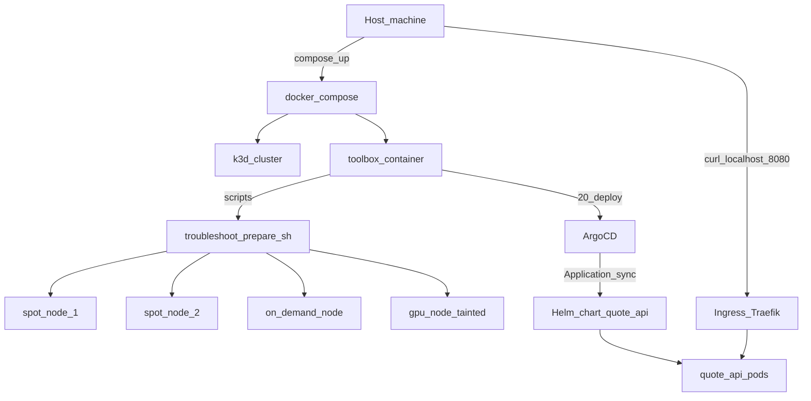
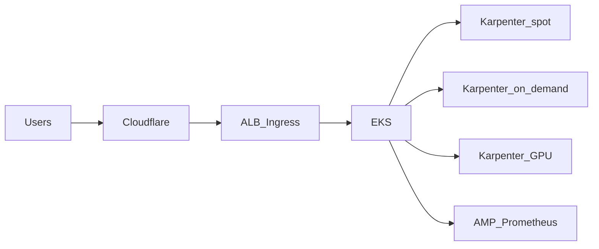

# DevOps take-home — quote-api

Local Kubernetes (k3d) + GitOps (ArgoCD) + CI/IaC/load-test tracks for the platform take-home.

## Quick start (Golden Rule)

```bash
git clone <your-repo> && cd <your-repo>
docker compose up -d
docker compose exec toolbox ./scripts/run-all.sh
```

On Linux/macOS with bash available you can also run `./scripts/run-all.sh` **inside** the toolbox (the compose service already mounts this repo at `/workspace`).

After CORE deploy:

```bash
curl http://localhost:8080/api/quote
```

**Requirements:** Docker with ~**8GB+** RAM (1 server + 4 agents + ArgoCD + kube-prometheus-stack).

## Architecture



### Bonus — production AWS sketch



## Script reference

| Script | What it does |
|--------|----------------|
| `scripts/bootstrap-cluster.sh` | Creates/reuses k3d (1s+4a), publishes host `:8080` → Traefik `:80` |
| `scripts/00-wait-cluster.sh` | Wait for API + ≥4 workers Ready |
| `scripts/10-prepare-nodes.sh` | Runs provided `troubleshoot/prepare.sh` (spot/OD/GPU) |
| `scripts/20-deploy.sh` | Build/import image, git-daemon + ArgoCD Application, wait healthy |
| `scripts/25-reclaim-drill.sh` | Drain one spot node; curl loop; reschedule proof; uncordon |
| `scripts/30-fix-troubleshoot.sh` | Apply `fixed-app.yaml`; run `verify.sh` |
| `scripts/50-validate-tf.sh` | `terraform fmt/init/validate` for Cloudflare |
| `scripts/60-loadtest.sh` | kube-prometheus-stack + k6 + HPA evidence |
| `scripts/run-all.sh` | Runs the above in order |

## Design decisions & trade-offs

- **Python + FastAPI** for a short readable API with Prometheus metrics (ADR-001).
- **k3d** for NetworkPolicy out of the box and containerized agents (ADR-002).
- **Semgrep hard-fail** instead of Sonar-in-compose (ADR-003).
- **Prefer spot + capacity topology spread (`minDomains: 2`)** so ≥1 replica stays on on-demand without pinning everything to OD (ADR-004). Soft hostname spread for reclaim.
- **Local git-daemon** feeds ArgoCD so the Golden Rule works before the repo is public; after publish, point `repoURL` at GitHub (same chart path).
- **ServiceMonitor** applied in Part 6 (CRDs not present at first Argo sync).
- Cuts: no Trivy/cosign/APM bonus; Terraform is validate-only.

Working contract: [`planning/`](planning/) · Assignment: [`ASSIGNMENT - DevOps.md`](ASSIGNMENT%20-%20DevOps.md)

## Troubleshooting notes (reviewer machine)

| Symptom | Likely cause | Fix |
|---------|--------------|-----|
| Compose/k3d OOM or hangs | Docker RAM too low | Raise Docker memory to ≥8GB; close other stacks |
| Port 8080 in use | Host conflict | Change `INGRESS_HOST_PORT` / compose publish and curl the new port |
| `prepare.sh` ERROR need ≥4 workers | Cluster created with too few agents | `k3d cluster delete devops-takehome` and `docker compose up -d --force-recreate` |
| Arm64 image pull issues | Platform mismatch | Build with `--platform linux/amd64` or multi-arch in CI |
| ArgoCD never Syncs | git-daemon seed / chart path | Re-run `20-deploy.sh`; check `kubectl -n argocd get application quote-api -o yaml` |

## Part 3

See [`TROUBLESHOOTING.md`](TROUBLESHOOTING.md). Do not delete default-deny or remove node taints/labels.

## Other docs

- [`docs/verification/index.html`](docs/verification/index.html) — verification report (ordered scripts + evidence screenshots; Part 6 blocked note)  
- [`AI-USAGE.md`](AI-USAGE.md) — AI disclosure  
- [`MIGRATION-NOTES.md`](MIGRATION-NOTES.md) — GitLab → GHA  
- [`LOADTEST.md`](LOADTEST.md) — k6 / HPA / bottleneck  
- [`OPS-ANSWERS.md`](OPS-ANSWERS.md) — Part 7  
- Image (CI): `ghcr.io/<owner>/<repo>/quote-api:<git-sha>`
