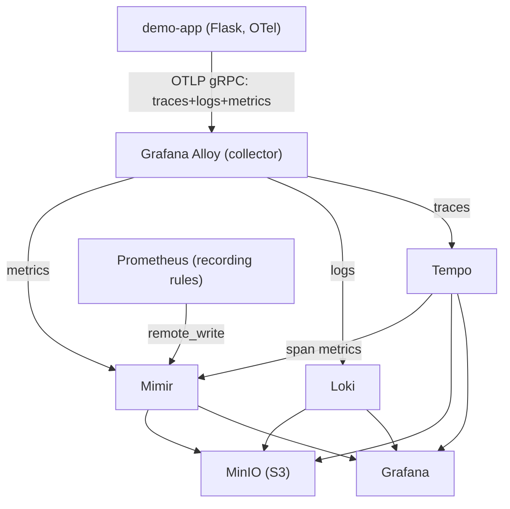

# Architecture Map - obs-platform

High-level orientation.

## Design principles

1. **Signal-per-backend separation** - metrics (Mimir), logs (Loki), traces (Tempo).
2. **Unified collection** - Grafana Alloy is the single OTLP entry point for app telemetry.
3. **Multi-tenancy from the ground up** - every hop carries `X-Scope-OrgID`.
4. **Object storage as the durable tier** - all backends persist to MinIO (S3).
5. **Correlation by convention** - trace IDs flow through logs and metric exemplars.

## Architecture Diagram

```mermaid
flowchart TD
    subgraph Application_Layer["Application Layer"]
        APP["demo-app (Flask + OTel)"]
    end

    subgraph Collection_Layer["Collection Layer"]
        PROM["Prometheus (recording/alert rules)"]
        ALLOY["Grafana Alloy (OTLP + self-scrape)"]
    end

    APP -->|OTLP gRPC| ALLOY

    subgraph Perf_Pipeline["Perf Pipeline - separate compose"]
        GATLING["k6"] --> GRAPHITE["graphite-exporter"]
        GRAPHITE --> PROM_MINI["prometheus-mini"]
    end

    PROM_MINI -->|remote_write (perf-tests)| MIMIR
    PROM -->|remote_write / remote_read| MIMIR

    ALLOY -->|metrics| MIMIR
    ALLOY -->|logs| LOKI
    ALLOY -->|traces| TEMPO

    subgraph Storage_Backends["Storage Backends"]
        LOKI["Loki (logs)"]
        TEMPO["Tempo (traces)"]
        MIMIR["Mimir (metrics)"]
        TEMPO -->|span metrics| MIMIR
    end

    LOKI --> MINIO["MinIO (S3 object storage)"]
    TEMPO --> MINIO
    MIMIR --> MINIO

    MIMIR --> GRAFANA["Grafana (dashboards + correlation)"]
    LOKI --> GRAFANA
    TEMPO --> GRAFANA
```

## High-level data flow



Every arrow carries a tenant header (`X-Scope-OrgID`).

## Component responsibilities (summary)

- **Alloy (main)** - OTLP receiver, memory limiter, batch processor; routes metrics/logs/traces to backends.
- **Mimir** - monolithic (`-target=all,alertmanager,overrides-exporter`); distributor, ingester, compactor, store-gateway, query-frontend, ruler, alertmanager, overrides-exporter.
- **Loki / Tempo** - log and trace backends with S3 storage; Tempo also emits span metrics and service graph data,
- **Prometheus** - evaluates recording rules across 19 groups plus demo-app alert rules and remote_writes/remote_reads to Mimir.
- **Grafana** - 5 provisioned datasources with derived fields / tracesToLogs / tracesToMetrics / serviceMap; 8 provisioned dashboards