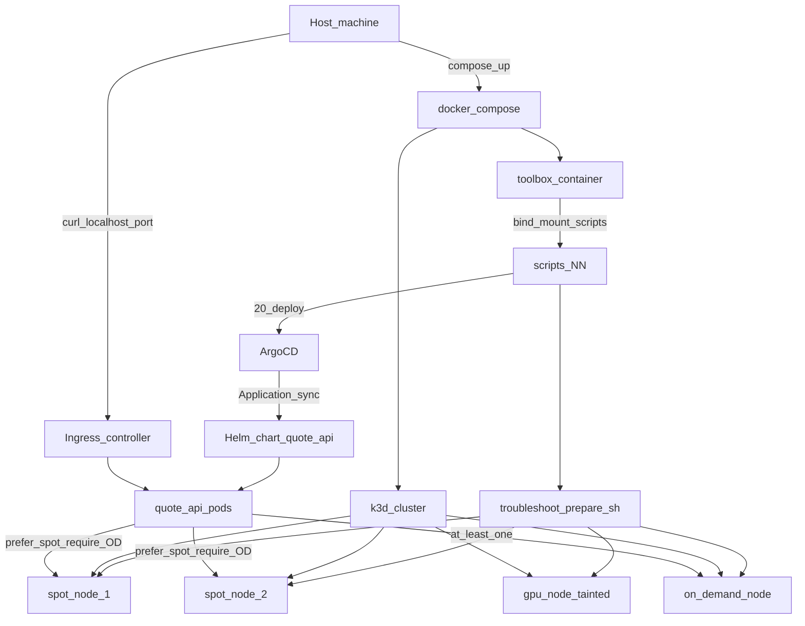
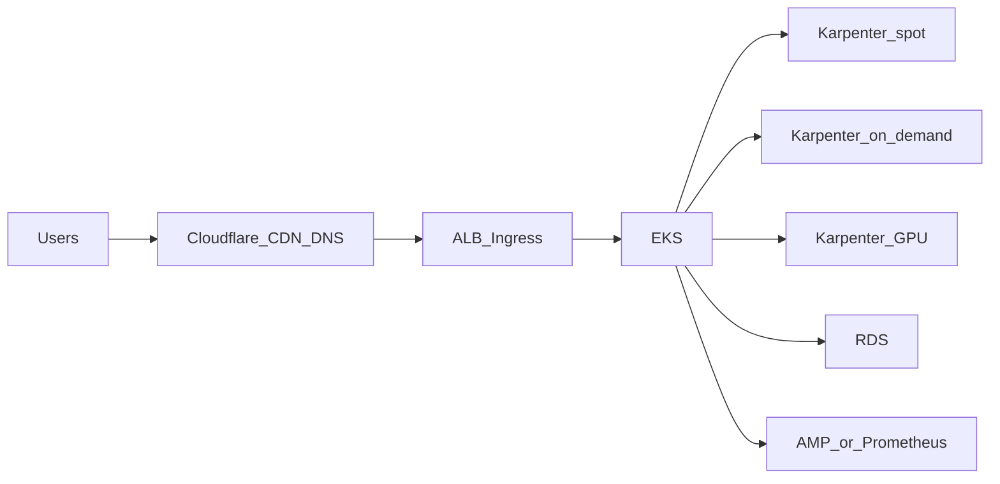

# Architecture

## Local harness (reviewer path)

## Components

| Piece | Role |
|-------|------|
| `docker-compose.yml` | Starts k3d (≥4 agents) + toolbox; mounts `./scripts` (and repo as needed) |
| Toolbox | kubectl, helm, terraform, k6; runs numbered scripts |
| k3d/k3s | Local Kubernetes; NetworkPolicy enforced (Part 3) |
| `prepare.sh` | Labels 2 spot, 1 on-demand, 1 GPU+taint |
| ArgoCD | Installs via script; Application points at repo Helm chart |
| Helm chart `quote-api` | Deployment, Service, Ingress, HPA, PDB, securityContext, affinity |
| Ingress | Host-reachable `http://localhost:<port>/api/quote` |

## Placement policy (Part 2)

With **minReplicas 3** (HPA):

1. **Prefer spot** — weighted node affinity / preferredDuringScheduling for `acme.io/capacity=spot`.
2. **Require one on-demand** — pod anti-affinity / topology or dedicated preferred + required mix so at least one replica schedules on `acme.io/capacity=on-demand` (e.g. soft prefer spot + a required “spread” or a second affinity schedule that keeps OD occupied — implement carefully; document in chart values).
3. **Soft topology spread** (`whenUnsatisfiable: ScheduleAnyway`) across `kubernetes.io/hostname` so reclaim/drain still allows reschedule.
4. **Avoid GPU** — do not match GPU labels; no toleration for `nvidia.com/gpu`.

Hard constraints that pin *all* pods to on-demand defeat the exercise.

## Ingress path

Host → published compose/k3d port → cluster Ingress → Service → Pods → `/api/quote`.

Exact port chosen at implementation time; document in root README and scripts.

## Part 6 observability overlay

kube-prometheus-stack scrapes ServiceMonitor / annotations on quote-api `/metrics`. Grafana dashboard + PrometheusRule live in-cluster; k6 hits the same Ingress URL.

## Bonus: production AWS outline (for root README)

Not implemented locally; diagram-only:

Boxes: EKS control plane; Karpenter nodepools (spot / OD / GPU); app Deployments; Cloudflare → ALB/NLB Ingress; RDS if stateful later; metrics/traces → managed Prometheus / OpenTelemetry.
